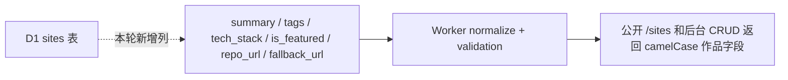

WARNING: self-review only, NOT independently verified

# Phase 4 作品集数据模型 -- 施工交工单

> 独立性: main-session-fallback | weak | model=unknown
> 日期: 2026-07-08

## 总结

本轮执行的是 `小茄的网站小岛 Phase 4 作品集数据模型设计`。设计里要求把现有站点记录升级成作品集作品：能保存一句话简介、标签、技术栈、精选状态、源码地址和 iframe 备用地址；后台能编辑这些字段；首页能轻量展示它们；`animal-island-ui` 不再只停留在登录页。代码层面这些能力已经接通，并通过测试、构建、Worker typecheck、migration、真实公开卡片和后台编辑链路验收。早期缺少公开数据和 admin session 的限制已在 BLOCKER-01 关闭时补证；REVIEW-09 最终独立复审确认 `vision_met`，当前没有剩余可执行 gap。

## spec 目标逐条对账

| spec 目标 | 状态 | 实际效果 | 备注 |
|-----------|------|----------|------|
| 新增 D1 migration，为 `sites` 表增加作品字段 | 完成 | 旧站点行升级后会获得空简介、空标签数组、空技术栈数组、非精选、空源码和空备用地址。 | migration 只做 `ALTER TABLE ADD COLUMN`，不回填推断数据。 |
| 扩展 Worker 数据读取、写入、校验和 API 映射 | 完成 | 创建、更新和公开列表都能流通新作品字段；损坏的标签 JSON 不会拖垮列表。 | Worker 仍是最终校验边界。 |
| 扩展 `shared/types.ts` 与 `shared/contracts.ts` 契约 | 完成 | 前端和 Worker 共享 camelCase 字段：`summary`、`tags`、`techStack`、`isFeatured`、`repoUrl`、`fallbackUrl`。 | D1 snake_case 没暴露给 React 组件。 |
| 扩展后台单一编辑面板，加入结构化作品信息编辑区 | 完成 | 管理员仍在同一个编辑面板里维护站点，同时可以编辑作品简介、标签、技术栈、源码、备用地址和精选开关。 | BLOCKER-01 已用真实 admin 登录、编辑、chip 添加和保存链路补证。 |
| 扩展首页作品卡，轻量展示作品元信息和精选逻辑 | 完成 | 代码会选择当前筛选范围内排序最靠前的精选作品，卡片会展示简介、标签、技术栈、源码入口和备用访问入口。 | BLOCKER-01 已用真实公开数据补齐桌面和移动浏览器证据。 |
| 在新增作品信息 UI 中显著运用或贴近 `animal-island-ui` | 完成 | 后台作品信息区和首页元信息区都使用了 `animal-island-ui` 的卡片、标签或按钮语言。 | `ui-ux-pro-max` skill 和 `screenpipe` 工具不可用是历史过程限制，不再影响当前 claim 覆盖。 |
| 保持静态导出、Worker 认证边界、live iframe 和 out-of-scope 边界 | 完成 | Next build 继续导出 `/` 和 `/admin`；前端没有引用 Worker secrets；未新增详情页、公益模块、社区功能、监控代理或强制截图/代理渲染。 | 真实部署环境仍需按项目部署流程复测。 |

## 施工细节

### 数据层和 Worker

改之前：

```text
sites 表只有基础站点字段 → API 只能返回站点名、URL、分类、描述等基础信息
```

改之后：



`worker/migrations/0002_portfolio_fields.sql` 增加 6 个低风险列。`worker/src/site-validation.ts` 负责 trim、去空值、去重、JSON stringify/parse 容错和 URL 校验。`worker/src/db.ts` 与 `worker/src/routes/sites.ts` 让这些字段进入现有 CRUD 和公开列表，没有新增平行 API。

### 共享契约和本地数据

`shared/types.ts` 和 `shared/contracts.ts` 统一扩展作品字段。`app/_data/demo-sites.ts` 给本地 demo 数据补了安全默认值，这样没有 API 数据时前端仍有一致的数据形状。

### 后台编辑

改之前：

```text
AdminSiteForm 只编辑基础站点信息 → 标签、技术栈、源码、备用地址没有结构化入口
```

改之后：

```text
AdminSiteForm 单一面板 → 作品信息区 → chip 输入 / URL 校验 / 精选开关 → 现有 API client 提交
```

后台没有新增页面、弹窗、拖拽排序、自动推荐或全局标签管理。标签和技术栈在前端先做 trim、去空值、去重并保持添加顺序；Worker 仍会再次校验。

### 首页展示

`app/_lib/portfolio-summary.ts` 增加精选拆分逻辑：当前过滤列表里先找 `isFeatured`，找不到就回退第一项，并从普通列表排除 featured。`app/_components/live-project-card.tsx` 继续保留 iframe、状态胶囊和访问按钮，只把元信息层升级成简介、标签、技术栈和源码入口。

`fallbackUrl` 只影响访问按钮的 loading/offline 备用入口，iframe 本身仍加载主 `site.url`。这避免把 Phase 4 做成复杂代理或截图兜底，同时让用户在加载或离线时有可点的备用地址。

### 视觉语言

后台作品信息区使用 `animal-island-ui` 的 `Card`、`Button`、`Tag`。首页作品卡使用 `Tag` 呈现 tags 和 techStack，用 `Button` 呈现源码入口；live iframe、状态合并、Worker API 和 D1 逻辑没有交给 UI 库。

## 验证情况

已运行并返回 0：

- `npm run test:admin`：26/26 通过。
- `npm run lint`：通过。
- `npm run build`：通过，静态路由包含 `/` 和 `/admin`。
- `worker` 目录下 `npm run typecheck`：通过。
- SQLite/D1 等效 migration：旧行升级后新字段默认值为 `summary=""`、`tags="[]"`、`tech_stack="[]"`、`is_featured=0`、`repo_url=null`、`fallback_url=null`。

历史上曾受限、现在已补证的部分：

- 真实首页公开卡片上的 tags、techStack、源码按钮和移动端视觉，已在 BLOCKER-01 通过真实公开数据补证。
- 后台作品信息区的登录后浏览器交互，已在 BLOCKER-01 通过真实 admin 会话补证。
- 外部 `codex exec` 审查因私有仓库传输风险被审批层拒绝；后续独立愿景 review 改用当前 Codex 内的 direct-spawn-agent。

## 后续可操作

## FOLLOWUP-03 证据更新

已在不启动新服务的前提下，用内置浏览器访问用户已有的 `http://localhost:3000/`。

- 桌面默认视口：页面标题为 `小茄的网站集合`，`articleCount=1`，`iframeCount=0`，`查看源码=0`，`访问网站=0`，无横向溢出。
- 移动 `390x844`：`articleCount=1`，`iframeCount=0`，`查看源码=0`，`访问网站=0`，`scrollWidth=390`，未发现溢出元素。
- 移动检查期间控制台记录 `/sites` 拉取失败：`无法获取站点列表 TypeError: Failed to fetch`。

因此，admin UI、首页真实作品元信息、源码按钮、animal-island-ui 首页可见性和移动端真实卡片布局仍不能按 real E2E 级别记为 covered。`CLAIM-019`、`CLAIM-022`、`CLAIM-023`、`CLAIM-024`、`CLAIM-027`、`CLAIM-029` 已在 claim ledger 中降为 `limited`。

## FOLLOWUP-04 当前状态

当前审查结果保持 `gaps_found`。claim ledger 现为 `27/34 covered`、`6 limited`、`claim_coverage_status:gaps`，CSV、review log 和本 handoff 已统一到同一表述。`FOLLOWUP-01`、`FOLLOWUP-02`、`FOLLOWUP-03`、`FOLLOWUP-04` 关闭后，还需要 `REVIEW-03` 再跑一次最强可用独立审查，才能决定是否把 Phase 4 标记为 `vision_met`。

REVIEW-03 已完成强独立复审，结论为 `limited_review`：代码缺口已修复，未发现新的可执行实现缺口；剩余 6 个 real E2E claim 只能等待真实 public `/sites` 数据和 admin session 后补证。CSV 已追加 `BLOCKER-01` 记录这个 human-required blocker。

BLOCKER-01 复查更新：本地 D1 已应用 `0002_portfolio_fields.sql`，公开 `/sites` 从 500 恢复为 200，并返回 3 条可见站点。桌面和移动浏览器都已看到真实 public cards、iframe 和访问按钮，移动端无页面级横向溢出，所以 `CLAIM-029` 已从 `limited` 调整为 `covered`。当前 claim ledger 为 `28/34 covered`、`5 limited`。剩余限制集中在本地数据缺少 tags/techStack/repoUrl/isFeatured/fallbackUrl，以及没有 admin session。

BLOCKER-01 已关闭：通过真实 Worker auth/CRUD 创建并编辑了一条 Phase 4 本地验收站点，首页桌面/移动都已渲染 summary、tags、techStack、源码按钮、访问按钮和 iframe；admin 页面也完成登录、编辑表单打开、作品信息区展示、chip 添加和更新保存。`CLAIM-019`、`CLAIM-022`、`CLAIM-023`、`CLAIM-024`、`CLAIM-027` 已补证为 `covered`。当前 claim ledger 为 `33/34 covered`、`1/34 out_of_scope`、`34/34 accounted`、`0 limited`，还剩 `REVIEW-04` 做最终独立复审。

REVIEW-04 又发现一个 Worker 边界缺口：外部 create/update payload 缺少 Phase 4 字段时会绕过校验并在归一化阶段变成 500。FOLLOWUP-05 已修复这个问题，缺失 `summary`、`tags`、`techStack`、`isFeatured`、`repoUrl`、`fallbackUrl` 现在都会在 Worker 校验层返回稳定错误；`npm run test:admin` 26/26 通过，`worker npm run typecheck` 通过。

REVIEW-05 继续挑出三处收尾问题：loading 状态下访问按钮没有优先使用 `fallbackUrl`，非字符串 `repoUrl`/`fallbackUrl` 仍可能穿过 Worker 校验，以及本交接文档还残留已关闭的 E2E 阻塞描述。FOLLOWUP-06 已让访问按钮在 iframe loading/offline 时优先打开备用链接，同时 iframe 仍加载主站点；FOLLOWUP-07 已让非字符串源码/备用链接返回稳定校验错误；FOLLOWUP-08 则把这份 handoff 调回当前状态。REVIEW-06、REVIEW-07、REVIEW-08 后续只发现 handoff 自身的状态指针残留，FOLLOWUP-09、FOLLOWUP-10、FOLLOWUP-11 已把这些指针清到当前状态。REVIEW-09 最终独立复审确认 Phase 4 达成 `vision_met`。

**还剩什么**

- Phase 4 当前已由 REVIEW-09 确认为最终通过，没有剩余 follow-up。

**阻塞/配置**

- 外部 `codex exec` review 当前被审批层拒绝，原因是会把私有仓库材料发送到外部审查进程；后续复审继续使用当前 Codex 内的 direct-spawn-agent 独立审查。

**怎么复现**

1. 配好 Worker/API 和 D1，确保公开 `/sites` 返回至少一条可见作品。
2. 打开 `http://localhost:3000/`。
3. 验证精选作品只出现一次；简介优先用 `summary`，没有则回退 `description`。
4. 验证 tags 最多显示 4 个，techStack 最多显示 5 个，源码按钮打开 `repoUrl`。
5. 切到移动宽度，确认标签换行、按钮不被挤压、文本不溢出、iframe 仍是主要展示区域。
6. 登录 `http://localhost:3000/admin`，编辑作品信息区，验证 chip 去重、URL 校验、精选提示、保存和取消行为。
