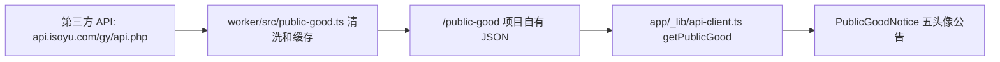

# Phase 5 施工交工单：公益公告和小岛化体验

WARNING: external review completed, but authenticated admin browser validation is still missing

独立性: strong for source/artifact review；登录后后台视觉验收仍缺真实浏览器会话。

## 总结

本轮执行的是 `docs/superpowers/specs/2026-07-08-public-good-animal-island-phase-5-design.md`。核心实现已经进仓：首页现在有公益公告模块，数据通过 Worker 的 `/public-good` 代理进入前端；首页和后台也从原来的监控/demo 面板感，往“作品小岛”和“岛务管理所”的方向推进了一步。外部独立 review 已经补跑，结论是核心实现路径成立，但还不能关闭为完全达成：登录后的后台页面没有真实浏览器会话验证，只完成了静态验证和未登录隔离检查。

## spec 目标逐条对账

| spec 目标 | 状态 | 实际效果 | 备注 |
|---|---|---|---|
| 首页首屏之后、作品列表之前新增“公益公告”模块 | 完成 | 用户打开首页会先看到“小茄的网站小岛”，再看到公益公告，然后才进入作品列表 | 浏览器检查确认公益公告在第一个作品卡之前 |
| 公益数据通过 Worker 代理接入第三方 API | 完成 | 前端只请求项目自己的 `/public-good`，不直接依赖第三方 CORS | Worker 内部请求 `https://api.isoyu.com/gy/api.php` |
| 每个缓存周期展示 5 条公益数据 | 完成 | Worker 会最多请求 8 次、按 id 去重，凑齐 5 条；不足时用缓存或 fallback 补齐 | 当前缓存用模块级内存缓存，符合本阶段可接受路径 |
| 公益模块采用 5 个头像 + 1 个详情告示牌 | 完成 | 首页公益公告显示 5 个头像入口，点击或悬停后切换详情牌 | 移动端用点击，不依赖 hover |
| 首页页面级 Animal Island 强化 | 完成 | hero 变成“作品小岛”告示牌；作品统计不再是 Total/Online/Unknown 指标条，而是中文小岛状态说明 | live iframe、状态 pill、访问入口仍保留 |
| 后台强化为“岛务管理所” | 部分完成 | 登录后的源码结构已经使用 animal-island-ui 的 Card/Button/Tag，并保留编辑、打开站点、删除确认等动作 | 缺少真实登录后浏览器视觉验收 |
| 保留核心架构和非目标边界 | 完成 | 静态导出、Worker API、D1 模型、live iframe、UptimeFlare 合并、单管理员 CRUD 都保留 | 未新增公益 CMS、曝光统计、多用户后台 |
| 保留 animal-island-ui 根样式导入和授权归因 | 完成 | `app/layout.tsx` 仍导入 `animal-island-ui/style`；README 说明 CC-BY-NC-4.0 和非商业约束 | 商业化前需要重新确认授权 |

## 施工细节

### 公益数据链路

改动集中在 `worker/src/public-good.ts`、`worker/src/index.ts`、`shared/contracts.ts` 和 `app/_lib/api-client.ts`。以前首页没有项目内公益数据契约；现在 Worker 会把第三方返回清洗成 `PublicGoodBatch`，前端只消费这个稳定 DTO。

你在首页打开页面 -> 前端先用本地备用公益公告渲染 -> 浏览器再请求 `/public-good` -> Worker 请求第三方 API、清洗字段、缓存 6 小时 -> 前端用返回的 5 条数据刷新公告。第三方失败时，首页不会空白，也不会影响作品列表。

### 首页体验

改动集中在 `app/_components/home-page.tsx`、`app/_components/public-good-notice.tsx`、`app/_components/portfolio-grid-client.tsx` 和 `app/_components/live-project-card.tsx`。以前首屏和作品列表更像监控面板；现在首屏使用“作品小岛 / 岛上公告”语义，公益公告作为公共告示牌插在作品列表前，作品状态变成“岛上现在有 X 间网站小屋”的轻量说明。

你点击公益头像 -> 详情告示牌会切换姓名、走失时间、走失地点、特征摘要和“查看详情”按钮。图片失败或没有图片时，会显示“暂无照片”占位，不会把整条公告隐藏。

### 后台体验

改动集中在 `app/_components/admin-dashboard.tsx` 和 `app/_components/admin-site-table.tsx`。未登录时仍然只显示密码输入；登录后源码结构已经转为“岛务管理所 / 岛上站点”，并用 animal-island-ui 的 Card、Button、Tag 替换部分裸按钮和容器。

你在后台登录后 -> 仍能看到站点列表、编辑、打开站点、删除确认和表单编辑面板 -> 只是外层语言和组件风格更接近小岛管理台。当前没有真实登录后的浏览器会话证据，所以这一项还不能说完全验收。

### 授权和文档

README 新增了 animal-island-ui attribution，明确当前按 CC-BY-NC-4.0 非商业使用处理，并提醒商业化前重新确认授权。

## 验证情况

- `npm run test:admin` 通过，33/33。
- `npm run lint` 通过。
- `npm run build` 通过，`/` 和 `/admin` 都是静态页面。
- `cd worker && npm run typecheck` 通过。
- 浏览器桌面验收：公益公告在作品列表前，5 个头像可见，点击头像能切换详情，无横向溢出，Total/Online/Unknown dashboard 文案已消失。
- 浏览器移动端 390x844 验收：5 个头像可见，详情字段可读，没有横向溢出。
- 浏览器 `/admin` 未登录态验收：只有一个密码输入，没有泄露站点列表或岛务管理所内容。

降级说明：

- 外部 `codex exec` 独立 review 已完成，结果保存在 `issues/2026-07-08_22-45-56-public-good-animal-island-phase-5.external-review-02.codex.md`；它没有发现核心实现缺口，但把登录后 admin 浏览器验收列为未完成证据。
- 登录后的 admin 视觉没有真实浏览器验收，因为当前会话没有本地 ADMIN_PASSWORD/session。
- 浏览器 console 中看到的 error 来自 live iframe 内的外部站点 `https://hjm.331106.xyz`，不是当前首页脚本。

## 后续可操作

还剩两件事：

1. 做登录后 admin 浏览器验收。解除条件是提供本地 admin 登录方式，或你自己在浏览器中登录后让 agent 继续检查。
2. 登录后验收补齐后，再跑一轮最终 review，确认 Phase 5 可以关闭为“完整达成”，或继续追加具体修复项。

你可以自己验证：

1. 保持本地 `http://localhost:3000` 已运行。
2. 打开首页，确认顺序是“小茄的网站小岛” -> “公益公告” -> 作品列表。
3. 在公益公告里点击 5 个头像，确认详情告示牌切换。
4. 缩到手机宽度，确认没有横向滚动。
5. 打开 `/admin`，未登录时应只看到密码输入；登录后应看到“岛务管理所”和“岛上站点”。
